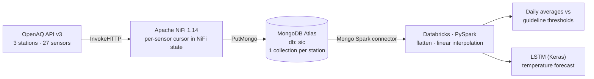

# Air Quality Monitoring Pipeline

An end-to-end data pipeline that ingests air-quality measurements for three monitoring
stations in Bengaluru from the [OpenAQ v3 API](https://docs.openaq.org), lands them in
MongoDB, and processes them with PySpark for gap filling, analytics against air-quality
guideline thresholds, and short-term forecasting.

> **Status:** this repository contains the original capstone version (v1), cleaned of
> credentials. A refactor into a reproducible, locally runnable pipeline is in progress —
> see [Roadmap](#roadmap-v2).

## Architecture (v1)

### Stations

| Area | OpenAQ location ID (Mongo collection) | Sensor IDs |
|---|---|---|
| Northwest Bengaluru | `3409393` | `12237640` – `12237648` |
| Northeast Bengaluru | `3409388` | `12237595` – `12237603` |
| Southwest Bengaluru | `3409385` | `12237568` – `12237576` |

### Ingestion — Apache NiFi

Flow: [`legacy/nifi_flow_v1.xml`](legacy/nifi_flow_v1.xml) (NiFi 1.x template).

1. `GenerateFlowFile` emits one trigger per sensor every 60 s, tagged with a `sensorID` attribute.
2. `RouteOnAttribute` fans each trigger out to that sensor's sub-flow.
3. `UpdateAttribute` advances a per-sensor cursor kept in NiFi local state
   (`seq = getStateValue("seq") + 1`).
4. `InvokeHTTP` calls
   `GET /v3/sensors/{sensorID}/measurements?page={seq}&limit=1&datetime_from=2025-01-01`.
   With a page size of 1, `seq` acts as a record offset.
5. `EvaluateJsonPath` + `RouteOnAttribute` check whether `results` is empty. If it is
   (no new measurement yet), the cursor is rolled back (`seq - 1`) and the request is
   retried with higher priority; otherwise the response is written to the station's
   collection with `PutMongo`.

### Processing — PySpark on Databricks

Notebook: [`legacy/databricks_notebook_v1.py`](legacy/databricks_notebook_v1.py)
(Databricks source format).

- **Flatten** the raw API documents (`explode(results)`) into
  `(local time, UTC time, interval, parameter, unit, value)`.
- **Gap filling**: invalid readings are treated as missing and filled by linear
  interpolation between the previous and next valid points, using Spark window functions
  (`last`/`first` with `ignorenulls`).
- **Analytics**: per-pollutant daily averages (CO, NO, NO₂, SO₂, O₃, PM2.5, PM10)
  normalised by guideline thresholds (e.g. PM2.5 15 µg/m³ and PM10 45 µg/m³, the WHO 2021
  24-hour guidelines) to show how many times the limit each day reaches.
- **Forecasting**: an LSTM (24-step window → next value) trained on a historical
  temperature dataset and evaluated on the interpolated station data.

## Running v1

Credentials are read from the environment, never from source:

| Where | Setting |
|---|---|
| NiFi | Export `MONGO_URI` and `OPENAQ_API_KEY` as environment variables before starting NiFi; the flow references them as `${MONGO_URI}` / `${OPENAQ_API_KEY}`. Upload the template, add it to the canvas and enable `MongoDBControllerService_Final`. |
| Databricks | Create a secret scope `air-quality` with key `mongo-uri`, attach the MongoDB Spark connector (10.x) to the cluster, and import the notebook. |

See [`.env.example`](.env.example). The CSV files the notebook reads from DBFS (training
data and exported measurements) are not part of this repository.

## Known limitations of v1

These are the problems the v2 refactor addresses:

- **Request-per-record ingestion** — `limit=1` means one HTTP call per measurement, and every
  sensor polls each minute regardless of whether new data exists.
- **Copy-pasted sub-flows** — 27 near-identical sub-flows, one per sensor; adding a sensor
  means editing the canvas.
- **Non-idempotent writes** — `PutMongo` inserts without a unique key, so replays create
  duplicates.
- **Notebook-only processing** — the transformation, training and "real-time" loop live in
  one interactive notebook; the loop never re-reads MongoDB, so it does not pick up new data.
- **Single-partition windows** — interpolation windows have no `partitionBy`, so Spark
  moves all rows to one partition.

## Roadmap (v2)

- [ ] Local stack with Docker Compose (NiFi + MongoDB) — no cloud account required
- [ ] One parameterised NiFi flow driven by a sensor list instead of 27 copies
- [ ] Watermark-based incremental load (`datetime_from` = last ingested timestamp, large
      page size) with upserts on `(sensor_id, datetime)` for idempotency
- [ ] Backfill job to rebuild history from the API
- [ ] PySpark jobs as a Python package: raw → cleaned/interpolated (partitioned by sensor) →
      daily aggregates, written as Parquet
- [ ] Data-quality checks and unit tests (`pytest` with a local SparkSession)
- [ ] CI with GitHub Actions (lint + tests)
- [ ] Dashboard on the aggregated layer

## Data source

Measurements are provided by [OpenAQ](https://openaq.org) via its public API; see OpenAQ's
terms for attribution and licensing of the underlying provider data.
